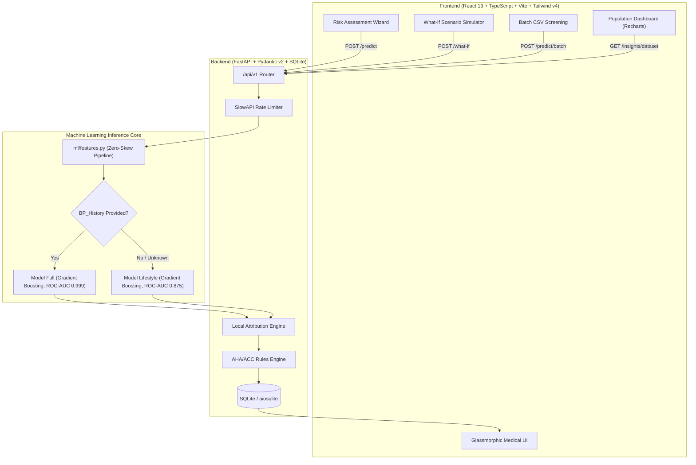

# CardioCare — Hypertension Risk Predictor 🩺⚡

> **Production-grade clinical decision support and preventative cardiometabolic risk engine.**  
> Powered by tuned Gradient Boosting with automated dual-model routing, interactive counterfactual what-if simulation, and zero train/serve feature engineering skew.

---

## 🏛️ System Architecture



---

## 🚀 Quickstart & One-Command Run

### Option 1: Docker Compose (Recommended)
Starts the FastAPI backend on `:8000` and the React frontend on `:5173`:
```bash
docker compose up --build
```
- **Web Interface:** [http://localhost:5173](http://localhost:5173)
- **FastAPI OpenAPI Interactive Docs:** [http://localhost:8000/docs](http://localhost:8000/docs)
- **API Health Check:** [http://localhost:8000/api/v1/health](http://localhost:8000/api/v1/health)

### Option 2: Local Development with Make
```bash
# 1. Install all dependencies, train models & generate metrics
make setup

# 2. Run backend in Terminal 1
make dev-backend

# 3. Run frontend in Terminal 2
make dev-frontend
```

---

## 🔬 Machine Learning Pipeline & Dual-Model Design

### 1. The BP_History Leakage & Dual-Model Solution
Permutation feature importance on the 1,985-row dataset showed that **BP_History dominates** (shuffling it drops ROC-AUC by ~0.29). A patient who already has diagnosed hypertension provides the answer directly to the model.

To provide clinical utility for both asymptomatic screening and established patient tracking, CardioCare trains and deploys **two tuned models**:
1. **`model_full.joblib`**: Incorporates `BP_History` alongside metabolic markers. Reaches **99.5% test accuracy** and **0.999 ROC-AUC**.
2. **`model_lifestyle.joblib`**: Completely omits `BP_History` and `Medication`. Reaches **87.5% ROC-AUC** (~78% accuracy). Evaluates cardiovascular risk strictly through modifiable lifestyle parameters (salt, sleep, stress, smoking, BMI, exercise).

### 2. Shared Feature Engineering (`ml/features.py`)
To prevent train/serve skew, both training scripts and the FastAPI service share the same deterministic feature transformations:
- **`BMI_Category`**: Underweight (<18.5), Normal (18.5–24.9), Overweight (25–29.9), Obese (≥30)
- **`Age_Group`**: 18–34, 35–49, 50–64, 65+
- **`Poor_Sleep`**: 1 if Sleep_Duration < 6 hours, else 0
- **`High_Stress`**: 1 if Stress_Score ≥ 7, else 0
- **`Lifestyle_Risk_Score`**: Composite 0–5 index summing smoking, low activity, poor sleep, high stress, and excess weight.

### 3. Retraining the Models
To reproduce training or retrain on updated data:
```bash
python ml/train.py
python ml/export_metrics.py
```

---

## 📡 REST API Examples (cURL)

### 1. Predict Individual Patient Risk (Full Model)
```bash
curl -X POST "http://localhost:8000/api/v1/predict" \
     -H "Content-Type: application/json" \
     -d '{
       "Age": 55,
       "BMI": 29.5,
       "Salt_Intake": 10.0,
       "Stress_Score": 8,
       "Sleep_Duration": 5.0,
       "Family_History": "Yes",
       "Exercise_Level": "Low",
       "Smoking_Status": "Smoker",
       "BP_History": "Prehypertension",
       "Medication": "None",
       "patient_id": "PT_DEMO_01"
     }'
```

### 2. Predict with Missing BP History (Auto-routed to Lifestyle Model)
```bash
curl -X POST "http://localhost:8000/api/v1/predict" \
     -H "Content-Type: application/json" \
     -d '{
       "Age": 38,
       "BMI": 24.2,
       "Salt_Intake": 6.0,
       "Stress_Score": 4,
       "Sleep_Duration": 7.5,
       "Family_History": "No",
       "Exercise_Level": "High",
       "Smoking_Status": "Non-Smoker"
     }'
```

### 3. What-If Counterfactual Intervention
```bash
curl -X POST "http://localhost:8000/api/v1/what-if" \
     -H "Content-Type: application/json" \
     -d '{
       "patient": {
         "Age": 55,
         "BMI": 29.5,
         "Salt_Intake": 10.0,
         "Stress_Score": 8,
         "Sleep_Duration": 5.0,
         "Family_History": "Yes",
         "Exercise_Level": "Low",
         "Smoking_Status": "Smoker",
         "BP_History": "Prehypertension"
       },
       "overrides": {
         "Salt_Intake": 4.5,
         "Sleep_Duration": 8.0,
         "Smoking_Status": "Non-Smoker",
         "Exercise_Level": "High"
       }
     }'
```

### 4. Batch Screening (CSV Upload)
```bash
curl -X POST "http://localhost:8000/api/v1/predict/batch" \
     -F "file=@cardiocare/ml/data/hypertension_dataset.csv"
```

---

## ⚙️ Environment Variables Reference

| Variable | Default Value | Description |
| :--- | :--- | :--- |
| `PROJECT_NAME` | `CardioCare — Hypertension Risk Predictor` | Application name in OpenAPI & logs |
| `API_V1_STR` | `/api/v1` | URL prefix for version 1 API endpoints |
| `CORS_ORIGINS` | `["http://localhost:5173","*"]` | Allowed CORS origins list |
| `RATE_LIMIT_DEFAULT` | `120/minute` | Rate limiting threshold per IP |
| `API_KEY` | *(empty)* | Optional write protection token header |
| `DATABASE_URL` | `sqlite+aiosqlite:///./cardiocare.db` | SQLAlchemy 2.0 async database URL |
| `VITE_API_BASE_URL` | `/api/v1` | Frontend API client base URL |

---

## 🧪 Testing Suite

### Run All Tests
```bash
make test
```

### Backend (Pytest Suite)
```bash
cd backend
python -m pytest app/tests/test_api.py -v
```
- Schema validation limits (Age 18–100, BMI 10–60, Salt 0–25, Stress 0–10)
- Sanity checks for known high-risk vs low-risk profiles
- Automatic routing to lifestyle model
- What-If counterfactual monotonicity
- Batch CSV processor with error tolerance
- Audit history persistence and deletion flow

### Frontend (Vitest Component Suite)
```bash
cd frontend
npm test
```
- `RiskGauge`: Circular SVG fill percentage & color tier verification
- `GlassCard`: Pointer spotlight and shine animation structure
- `ContributingFactorsChart`: Diverging signed bars and clinical narratives

### End-to-End Smoke Test (Playwright)
```bash
cd frontend
npx playwright test
```

---

## 🖼️ User Interface & Feature Tour

1. **Home / Hero (`/`)**: Animated ECG trace, clinical trust metrics (99.5% Acc, 87.5% AUC, 1,985 records), shine feature cards, and medical disclaimer.
2. **Assessment Wizard (`/assessment`)**: 3-step wizard with real-time sliders for Salt, Sleep, and Stress; segmented controls for physical activity; interactive BMI calculator helper; and a toggle for unknown BP history.
3. **Assessment Results (`/result`)**: Dynamic circular risk gauge (Mint <35%, Amber 35–65%, Coral >65%), signed contributing factors diverging chart, personalized clinical recommendations (DASH diet, sleep hygiene), and interactive **What-If Counterfactual Simulator**.
4. **Insights Dashboard (`/dashboard`)**: Class balance donut chart, hypertension prevalence across demographic categories, age distribution histograms, permutation importance bars, ROC comparison curves, and model comparison table.
5. **Batch Prediction (`/batch`)**: Drag-and-drop CSV upload for up to 5,000 patient records, preview grid, risk tier filtering, and one-click enriched CSV export.
6. **Prediction History (`/history`)**: Searchable SQLite audit log of past predictions with biometric records and record deletion.
7. **Model Methodology (`/about`)**: Transparent documentation on synthetic data characteristics, clinical caveats, and technical architecture.

---

## ⚠️ Medical & Synthetic Data Notice
*CardioCare is an educational prototype and decision-support demonstration. The training dataset shows characteristics of synthetic generation (high separability and near-uniform demographic distributions). It is not certified as an autonomous diagnostic device under FDA/CE regulations. Prospective clinical validation is strictly advised.*
